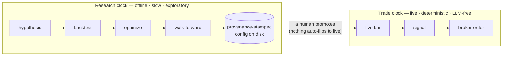

# Architecture

## The mental model: two clocks

Before the layers, the one idea that explains the most: QuantRed runs on **two
clocks**, and they never touch.



The research clock may be non-deterministic and LLMs are allowed there; it only
ever emits configs and rationale to disk. The trade clock reads a
human-approved config and nothing else.

- **The research clock** is where intelligence and non-determinism live —
  parameter search, walk-forward validation, and the optional AI research agent.
  It only ever *proposes*: it writes provenance-stamped candidate configs to disk.
- **The trade clock** (`quantred/engine/live.py` → `quantred/execution/`) is deliberately
  dumb: a live bar produces a signal produces an order. No model sits in the order
  path, so there's nothing to prompt-inject and nothing non-deterministic to debug
  when real money is at stake. It imports **nothing** from `services/`, `analytics/`,
  `optimization/` or `research/`; a structural test asserts it. It may import the
  leaf layers it needs (`strategies/`, `marketdata/`, `brokers/`, `costs/`, `utils/`),
  and the sizing rules both clocks share live in `quantred/execution/sizing.py` so the
  backtest imports them from the trade clock rather than the reverse. The price of the
  separation is that some ideas exist twice; see
  [separation of concerns](separation-of-concerns#the-price-of-two-clocks).
- **Promotion is a manual human step.** Automation never flips `PAPER_TRADE` or
  routes an order. The [MCP server](mcp-server) enforces this *structurally* — it
  builds only a data client, so it physically cannot trade.

Everything below is how the code is arranged to keep those two clocks separate.

## The layers

The system is a stack of single-responsibility layers. Dependencies point
**downward only**, and nothing above the broker layer imports a vendor SDK.

```
   quantred/cli.py  (CLI: wires everything per command; main.py is a shim)
   quantred/mcp/ → services/  (the same services, read-only, over MCP)
                    │
        ┌───────────┼─────────────┬───────────────┐
     engine/     optimization/   portfolio/        │
   (orchestrate)  (tune params)  (weight positions)│
        │                                          │
   ┌────┴─────┬───────────┬──────────┐             │
strategies/  scanners/  execution/  analytics/     │
        │        │          │                      │
        └────────┴────┬─────┴──────────────────────┘
                 marketdata/        brokers/  (interfaces)
                      │                 │
                      └── brokers/alpaca/ (the only SDK adapter)
                 indicators/   utils/   (leaf helpers)
```

### The packages

| Package | Responsibility |
|---------|----------------|
| `brokers/` | `Broker` interface, domain types (`OrderSide`, `Position`, `AccountSnapshot`, `OrderResult`, `MarketStatus`), and the `BrokerError` hierarchy |
| `brokers/alpaca/` | `AlpacaBroker` + `AlpacaMarketData` — the only modules that import `alpaca` |
| `marketdata/` | `MarketDataProvider` interface, `Timeframe`, `MarketDataClient`, `BarEvent` |
| `indicators/` | Pure pandas/numpy technical indicators |
| `strategies/` | `Strategy` base, the signal vocabulary, and concrete strategies |
| `scanners/` | `ScannerStrategy` base, concrete scanners, and the `SymbolScanner` |
| `execution/` | `LiveTrader` (signals → broker orders), the `Decision` it returns, deterministic order ids, the position ledger, and halt/flatten |
| `analytics/` | Performance metric primitives, backtest metrics, reporting |
| `engine/` | `BacktestEngine` + `LiveEngine` — orchestration only — and the live bar-quality guards |
| `optimization/` | `ParameterSpace` + `ParameterOptimizer` |
| `portfolio/` | `PortfolioAllocator` — OR-Tools position weighting |
| `costs/` | `CostModel` and `ParametricCostModel` — shared by the backtest, the optimizer and the live cost *record* |
| `risk/`, `alphas/`, `data/` | covariance estimation, alpha combination and refinement, and the research data panel |
| `store/` | the trial journal's SQLite index and the on-disk bar cache |
| `services/` | the JSON-returning boundary the CLI and the MCP server both call (research clock) |
| `research/` | the optional AI research agent and its sandbox (research clock) |
| `mcp/` | the read-only MCP server — a thin adapter over `services/` |
| `utils/` | logging, numeric, timezone and streaming helpers |

## Guiding principles

- **Interfaces at the boundary.** The engine talks to a `Broker` and a
  `MarketDataClient`, never to Alpaca directly. See
  [Broker Abstraction](broker-abstraction).
- **One job per module.** Signals, sizing, fills, metrics, and execution each
  live in different layers. See [Separation of Concerns](separation-of-concerns).
- **No hidden heavy dependencies.** scikit-learn and OR-Tools are optional extras,
  imported lazily.
- **Everything is testable offline.** Because the boundary is an interface, tests
  inject in-memory fakes. See [Testing](testing).

For running it rather than reading how it is built, start with the [usage guide](../usage/getting-started.md) and [live trading](../usage/live-trading.md).
